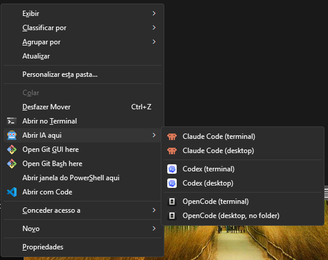
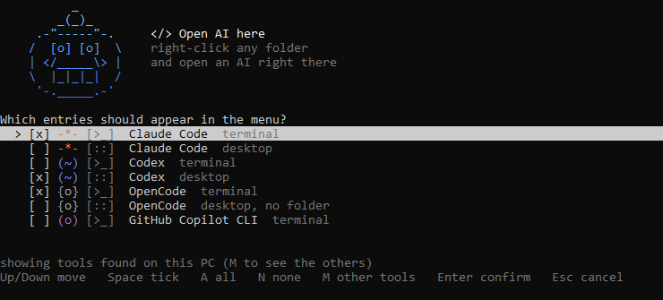

# Open Claude Here

Right-click any folder in Windows Explorer → **Open AI here** → pick a tool and where to run it. No more `cd C:\Users\...` before starting a session.

Clique com o botão direito em qualquer pasta → **Abrir IA aqui** → escolha a ferramenta e onde abrir. Sem precisar digitar `cd` antes.



The installer detects what you have and shows only the entries you pick. It works in two places:

- Right-click **on a folder**
- Right-click the **background inside a folder** (works in empty folders too)

## What opens what

| Entry | What it does | Notes |
|---|---|---|
| Claude Code (terminal) | `wt.exe -d <folder> claude` | falls back to `cmd.exe` without Windows Terminal |
| Claude Code (desktop) | opens `claude://code/new?folder=<folder>` | Claude Desktop asks you to confirm the folder. If the app is already open, the folder may be added to the current window. |
| Codex (terminal) | runs `codex` in the folder | |
| Codex (desktop) | `codex app <folder>` | |
| OpenCode (terminal) | runs `opencode` in the folder | |
| OpenCode (desktop, no folder) | opens the app | OpenCode Desktop has no way to open a folder from outside (its `opencode://` links only handle login), so pick the project inside the app. |
| Gemini CLI (terminal) | runs `gemini` in the folder | not tested yet |
| GitHub Copilot CLI (terminal) | runs `copilot` in the folder | not tested yet |
| Cursor (desktop) | `cursor <folder>` | not tested yet |

Setup only lists the tools it finds on your PC. Press **M** in the list to see the ones it knows but did not find.

The first three tools are tested. The other three follow each tool's documented command but were not run by the author, so please [open an issue](https://github.com/BabyCatBE/open-claude-here/issues) if one misbehaves. Want another tool? See [Adding a tool](#adding-a-tool).

## Requirements

- Windows 10/11
- At least one of the supported tools: [Claude Code](https://claude.com/claude-code), [Codex](https://developers.openai.com/codex), [OpenCode](https://opencode.ai), Gemini CLI, GitHub Copilot CLI or Cursor (CLI in your PATH, and/or the desktop app)
- [Windows Terminal](https://aka.ms/terminal) (recommended; falls back to `cmd.exe` if missing)

## Install, configure, uninstall

One file does all three: **`setup.cmd`**. Download or clone the repo and double-click it.

```powershell
git clone https://github.com/BabyCatBE/open-claude-here.git
cd open-claude-here
.\setup.cmd
```



- **Not installed yet:** it offers only **Install**. Press Enter and you get the checklist below, with the tools found on your PC already ticked. Press Enter again to confirm.
- **Already installed:** it offers **Configure** (pick which entries appear) and **Uninstall**.

Each row has a small symbol for the tool (`-*-` Claude, `(~)` Codex, `{o}` OpenCode, `<*>` Gemini, `(o)` Copilot, `[>]` Cursor), followed by `[>_]` for the terminal or `[::]` for the desktop app. Use the keyboard:

| Key | Action |
|---|---|
| **Up / Down** | move between entries |
| **Space** | tick or untick the highlighted entry |
| **A** / **N** | tick all / untick all |
| **M** | also show the tools that were not found on this PC |
| **Enter** | confirm |
| **Esc** | cancel without changing anything |

The Configure / Uninstall question works the same way (Up / Down, Enter, Esc). When setup is run from a script with piped input, it falls back to typing numbers.

No admin rights needed: everything is written under `HKCU` (your user only), plus files copied to `%LOCALAPPDATA%\ClaudeCodeContextMenu`.

## Choose what appears in the menu

Don't want all the entries? Pick only the ones you use, now or later.

**Changing it after install** works even if you delete the cloned repo, because setup keeps its own copy in `%LOCALAPPDATA%\ClaudeCodeContextMenu`. Open **Open AI here - Setup** from the Start menu (or run `setup.cmd` from that folder) and choose **Configure**. The checklist opens with your previous choice.

Without any questions (for scripts):

```powershell
# install everything detected
.\setup.ps1 -NoPrompt

# only terminal entries, for Claude Code and Codex
.\setup.ps1 -Tools claude,codex -Modes terminal

# an exact list of entries (tool-mode)
.\setup.ps1 -Entries claude-terminal,codex-desktop,opencode-terminal

# custom submenu text
.\setup.ps1 -Label "AI here"

# skip the question: -Action install | configure | uninstall
.\setup.ps1 -Action configure
```

Your choice (and the menu text) is saved in `%LOCALAPPDATA%\ClaudeCodeContextMenu\config.json`. Running setup again replaces the previous menu (including the old single "Open Claude Code here" entry).

## Windows 11 note

Windows 11's new context menu hides classic entries. Use **Show more options** (or **Shift + right-click**) to see it. Showing it in the new menu requires a signed shell extension package, which is out of scope here.

## Uninstall

Open `setup.cmd` (from the repo, or **Open AI here - Setup** in the Start menu) and choose **Uninstall**. It removes the menu, the Start menu shortcut and the install folder. Or: `.\setup.ps1 -Action uninstall`.

## How it works

A submenu defined once under `HKCU\Software\Classes\Directory\ContextMenus\AIHere`, referenced by two parent entries:

| Key | Triggered by |
|---|---|
| `Directory\shell\AIHere` | right-click on a folder |
| `Directory\Background\shell\AIHere` | right-click inside a folder |

Each item uses `%V` (the folder) as its working directory. Terminal items call `wt.exe` directly; desktop items go through `open-ai-desktop.ps1`. Which tools exist, and how each one is detected and opened, is described in `tools.json`.

## Adding a tool

Every tool is one entry in `tools.json`, so adding one needs no code. Copy an existing entry and change it:

```json
{
  "id": "gemini",
  "name": "Gemini CLI",
  "color": "66;133;244",
  "glyph": "<*>",
  "icon": "gemini.ico",
  "terminal": { "exe": "gemini", "command": "gemini" }
}
```

| Field | Meaning |
|---|---|
| `id`, `name` | short id (used in `-Tools` and `-Entries`) and the name shown in the menu |
| `color`, `glyph` | RGB colour and the 3-character symbol shown in the setup list |
| `icon` | an `.ico` in `assets\` for the Explorer menu (the robot icon is used if the file is missing) |
| `terminal` | `exe` is what setup looks for in your PATH; `command` is what runs in the folder |
| `desktop` | optional. `detect` finds the app (`appx` package name, `path`, or `exe`); `open` says how to open a folder: `uri` (a deep link, `{folderEncoded}` is the folder), `run` (a command, `{folder}` is the folder) or `launch` (just start the app); `note` adds a hint to the label |

## Icons

- Submenu robot: [Twemoji](https://github.com/jdecked/twemoji) 🤖 (© Twitter, Inc. and contributors, [CC-BY 4.0](https://creativecommons.org/licenses/by/4.0/))
- Claude Code: pixel-art robot made for this project
- Codex: the Codex logo from [LobeHub Icons](https://github.com/lobehub/lobe-icons) (MIT), rendered as `.ico`
- OpenCode: the icon embedded in the OpenCode desktop app
- Gemini CLI, GitHub Copilot CLI and Cursor: simple letter badges in each brand colour, not the official logos
- The Codex and OpenCode logos belong to OpenAI and the OpenCode project respectively, and are used only to identify each tool in the menu.

## License

MIT
